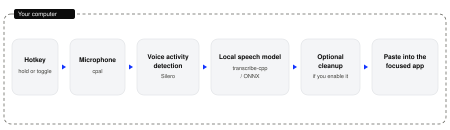

<p align="center">
  <picture>
    <source media="(prefers-color-scheme: dark)" srcset="assets/branding/banner-dark.png" />
    <source media="(prefers-color-scheme: light)" srcset="assets/branding/banner-light.png" />
    
  </picture>
</p>

<h1 align="center">Coco Voice</h1>

<p align="center">
  Private on-device dictation and meeting notes for macOS, Windows x64, and Linux x64.
</p>

<p align="center">
  <a href="LICENSE"
    ></a>
  <a href="https://github.com/coco-research/Coco-Voice/releases/latest"
    ></a>
  
</p>

## Why it exists

Talking is faster than typing, but most dictation tools record you, send the audio to a server, and bill you monthly. Coco Voice runs the speech model on your own computer. Hold a key, speak, and the text is pasted into whatever field you are in: a chat, an editor, an email. No account, no subscription, and recognition works offline once your model is downloaded.

## Quick start

### For users

Release `0.20.2` targets macOS (`Coco.Voice_0.20.2_aarch64.dmg` for Apple Silicon and `Coco.Voice_0.20.2_x64.dmg` for Intel), Windows `x64` (`Coco.Voice_0.20.2_x64-setup.exe` per-user NSIS installer with bundled ONNX Runtime, plus `_x64_en-US.msi`), and Linux (`_amd64.AppImage`, `_amd64.deb`, and `.x86_64.rpm`). Every release publishes `SHA256SUMS`, `latest.json`, and minisign `.sig` updater signatures. Step-by-step macOS, Windows x64, and Linux x64 install and checksum verification instructions are in [INSTALL.md](INSTALL.md).

- **macOS (Apple Silicon & Intel):** Download the `.dmg` for your Mac from the [latest release](https://github.com/coco-research/Coco-Voice/releases/latest), drag **Coco Voice** into **Applications**, and on first launch right-click **Coco Voice** in Applications → **Open** → **Open** (a one-time step while builds use self-signed code signing rather than paid Apple notarization).
- **Windows x64:** Download `Coco.Voice_0.20.2_x64-setup.exe`, optionally verify its SHA-256 with `Get-FileHash` against `SHA256SUMS`, and if Windows SmartScreen prompts on first launch click **More info** → **Run anyway**.
- **Linux x64:** Download `Coco.Voice_0.20.2_amd64.AppImage` (`chmod +x` and run) or install `Coco.Voice_0.20.2_amd64.deb` / `.x86_64.rpm`.

On first launch macOS asks for Microphone and Accessibility permissions (Accessibility enables the global push-to-talk shortcut and paste keystroke; signing with the fixed Coco Research certificate preserves Accessibility across updates). Choose and download a local speech model in onboarding — default push-to-talk is `Option+Space` on macOS and `Ctrl+Space` on Windows and Linux.

### Build from source

You need Rust (stable), [Bun](https://bun.sh/), and cmake.

On macOS, install full Xcode and point the active developer directory at it (`sudo xcode-select -s /Applications/Xcode.app`). With only Command Line Tools, the Apple Intelligence bridge compiles as a stub. The published 0.9.5 disk image was built that way, so Apple Intelligence is unavailable in that download.

Windows also needs the Microsoft C++ build tools and the Vulkan SDK. Linux needs the libraries listed in [BUILD.md](BUILD.md), including cmake. Intel Macs have no prebuilt ONNX Runtime in this repo. [BUILD.md](BUILD.md) has the Homebrew link flags.

```bash
bun install

mkdir -p src-tauri/resources/models
curl -o src-tauri/resources/models/silero_vad_v4.onnx https://blob.handy.computer/silero_vad_v4.onnx

bun run tauri dev
```

If cmake stops on a policy error:

```bash
CMAKE_POLICY_VERSION_MINIMUM=3.5 bun run tauri dev
```

## What it does

- Hold a key to dictate, and the text lands in the focused app. Push-to-talk is the default (Option+Space on macOS, Ctrl+Space on Windows and Linux). Turn it off to toggle, or drive a running copy with `--toggle-transcription`.
- You pick a local model: Whisper, Parakeet, Moonshine, and other architectures, through transcribe-cpp, with older ONNX models through transcribe-rs.
- transcribe.cpp uses the GPU when one is there: Metal on macOS, Vulkan on Windows x64 and Linux, and the CPU otherwise. A Windows on ARM build of the speech engine is CPU only.
- You can clean a transcript afterwards through an OpenAI-compatible API, or through Apple Intelligence on Apple Silicon when that provider was compiled in. The 0.9.5 download does not include Apple Intelligence because the provider is a stub.
- Names and fixes stay local: custom words, whole-word corrections, and a transcript history stored in a database on disk.
- The settings window is translated into 22 languages.

## How it works



The shortcut opens the microphone through cpal. Silero voice activity detection drops silence. A local model turns the speech into text: transcribe-cpp for the GGUF catalog, transcribe-rs for an older ONNX model. Cleanup is separate, and it runs only when that step is enabled and the chosen provider is actually available. The text is pasted into whichever app is focused.

## Status and roadmap

Coco Voice `0.20.2` ships local dictation, custom vocabulary and whole-word corrections, local SQLite transcript history, minisign-verified in-app updates, and local meeting capture/notes infrastructure. See [CHANGELOG.md](CHANGELOG.md) for version-by-version changes and [INSTALL.md](INSTALL.md) for platform setup notes.

## Models and licences

The application is [MIT](LICENSE). Each speech model keeps its own licence, and Coco Voice only offers models whose licences allow it. These were removed in 0.9.5 and won't load even if you already downloaded them. If you used one, pick another model in Settings > Models.

- **Held for licence review (custom licences)**: Parakeet Unified EN 0.6B, Nemotron Streaming 3.5, Nemotron Speech Streaming EN, MedASR, SenseVoice Small.
- **Non-commercial licences**: Canary 1B, Moonshine Tiny (Vietnamese), Moonshine Tiny (Ukrainian), Moonshine Tiny (Korean), Moonshine Tiny (Chinese), Moonshine Tiny (Arabic), Moonshine Tiny (Japanese), Moonshine Base (Vietnamese), Moonshine Base (Ukrainian), Moonshine Base (Korean), Moonshine Base (Chinese), Moonshine Base (Arabic), Moonshine Base (Japanese).
- **Built-in model removed**: SenseVoice (`sense-voice-int8`).

Licence details: [NOTICE](NOTICE).

## Contributing

See [CONTRIBUTING.md](CONTRIBUTING.md) and [CONTRIBUTING_TRANSLATIONS.md](CONTRIBUTING_TRANSLATIONS.md).

Coco Voice is in a feature freeze. A pull request for a new feature the community has not asked for is rejected. If the community has asked for it, or you have gathered support for it, it may still be considered. Bug fixes come first. The freeze is spelled out in CONTRIBUTING.md.

## Licence

[MIT](LICENSE).

## Credits

Coco Voice is a fork of [Handy](https://github.com/cjpais/Handy) by CJ Pais, which is also MIT. Handy is the speech pipeline this app still runs: recording, local models, shortcuts, and paste. Thank you to CJ Pais and the Handy contributors.

On top of that fork, Coco Voice adopted the Coco Research luminous orb mark and deep-space blue theme, added macOS and Windows x64 installer packaging plus minisign-verified GitHub Release updates, added Apple Intelligence as an on-device cleanup provider when built with full Xcode, and added a speak-a-correction shortcut that learns from history edits.

Key libraries: [transcribe-cpp](https://github.com/handy-computer/transcribe.cpp), transcribe-rs, Silero VAD, and [Tauri](https://tauri.app/).

## More

### Platforms

| Where you run it | What the code does                                                                                                                      |
| ---------------- | --------------------------------------------------------------------------------------------------------------------------------------- |
| macOS            | Apple Silicon (`aarch64`) and Intel (`x64`) disk images. `transcribe.cpp` uses Metal. First launch asks for Microphone & Accessibility. |
| Windows x64      | Per-user x64 `-setup.exe` (bundled ONNX Runtime) and `.msi`. `transcribe.cpp` uses Vulkan with CPU fallback.                            |
| Linux x64        | `amd64` `.AppImage`, `.deb`, and `x86_64` `.rpm`. `transcribe.cpp` uses Vulkan with CPU fallback. Recording overlay is off by default.  |

On Linux, `HANDY_NO_GTK_LAYER_SHELL=1` skips the GTK layer-shell overlay. Wayland paste depends on a typing tool such as `wtype`, `ydotool`, `dotool`, or `xdotool`. Install notes and the long build troubleshooting (Windows path length, AppImage, Intel Mac ONNX Runtime) are in [BUILD.md](BUILD.md).

### Debug

`Cmd+Shift+D` on macOS, or `Ctrl+Shift+D` on Windows and Linux, toggles debug mode.

### Command line

These flags apply to this launch only. They do not change saved settings. If the app is already running, `--toggle-transcription`, `--toggle-post-process`, and `--cancel` are forwarded to it and the new process exits. Any other second launch brings the settings window forward.

```bash
coco-voice --toggle-transcription
coco-voice --toggle-post-process
coco-voice --cancel
coco-voice --start-hidden
coco-voice --no-tray
coco-voice --debug
```

`--transcribe-file` transcribes a 16 kHz mono WAV with a model that is already installed. It does not open the microphone, run voice activity detection, or download anything. `--json` prints that result as JSON. `--list-models` and `--list-devices` print what this build can load.
